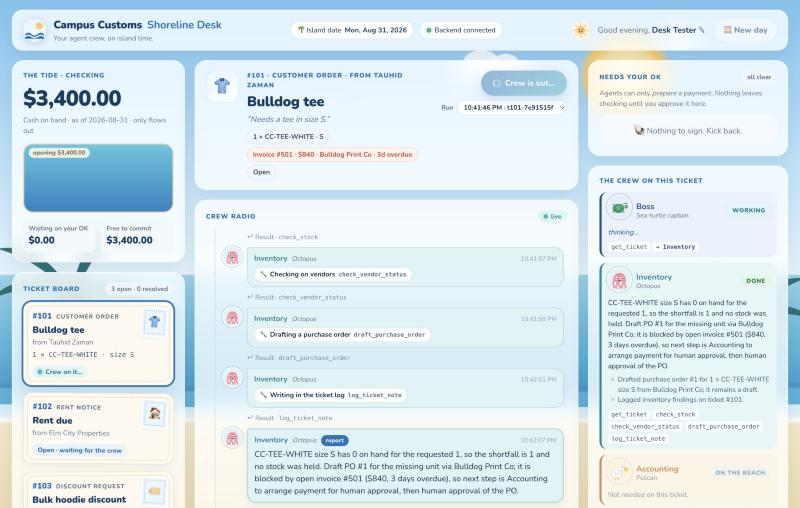
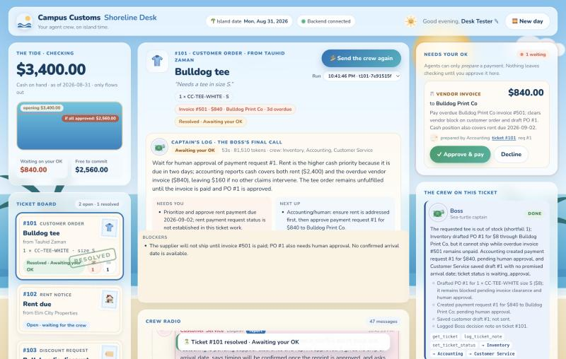
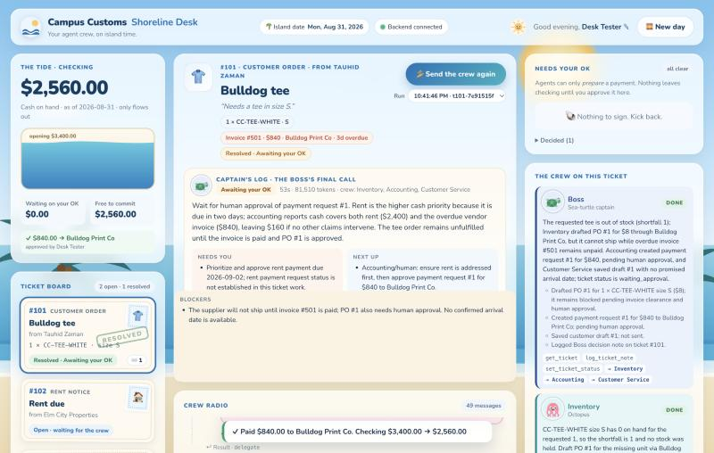

# Shoreline Desk: dashboard design

**What it is:** the React + Vite + TypeScript board in `frontend/` for the Campus Customs agent crew. Start it with `npm run dev` in `frontend/`. It calls the FastAPI backend at `http://localhost:8000`, which you can override with `VITE_API_URL`.

**The idea in one line:** a calm desk on a tropical shoreline. You watch five friendly sea creatures work your tickets over a crew radio, and nothing important (money, customers) moves without you.

| Live run | Ticket resolved, approval waiting | After you approve |
|---|---|---|
|  |  |  |

---

## What I referenced, and what I took from each

I looked at the dashboards that keep topping 2026 "best SaaS dashboard" lists, plus the two apps most praised for feeling calm. I borrowed one specific idea from each rather than copying any one product.

| Reference | Why it's admired | What I took |
|---|---|---|
| **Linear** | Quiet chrome; status cards you read at a glance (title, owner, status in a fixed hierarchy) | The **ticket postcards** use the same fixed order on every card (number → type → subject → requester → item → status) so three tickets read in one glance |
| **Stripe** | Money shown plainly; one key number in the top-left; no decoration on financial data | **The Tide** (cash) is the top-left card and the biggest number on the page. Money tables (approvals, paid receipts) stay plain and tabular |
| **Vercel** | Near-monochrome UI where *color means something* | Base UI is blue and white. Color is reserved for meaning: green = resolved/paid, amber = waiting on you, coral = refused/blocked, and one color per agent |
| **Headspace / Calm** | Warm cream canvas, rounded type, friendly mascots, breathing-pace motion | Cream postcards, the rounded **Nunito** font (close to Calm's Visby Round), a mascot for each agent, and motion on slow 4–9s "breathing" loops |

## Layout: three columns, read left to right like a shift

```
┌──────────── Header: brand · island date · backend status · who's at the desk · 🌅 New day ────────────┐
│ THE TIDE (cash)          │ TICKET STAGE (selected ticket + 🏄 Send the crew)  │ NEEDS YOUR OK (approvals) │
│ TICKET BOARD (postcards) │ Captain's log (Boss's final call, after the run)   │ THE CREW ON THIS TICKET   │
│                          │ CREW RADIO (live feed of every agent step)         │ MESSAGES IN A BOTTLE      │
└──────────────────────────┴────────────────────────────────────────────────────┴───────────────────────────┘
```

- **Left, "what's on my plate":** cash first, then the three tickets. Pick a postcard to put it on the stage.
- **Center, "what's happening":** the selected ticket, one big **Send the crew** button, then the **Crew Radio**, a live feed that scrolls by itself while agents work. When the run ends, the **Captain's log** card appears above the feed with the Boss's decision, what needs you, next steps, blockers, duration, and tokens.
- **Right, "what do you need from me":** **Needs your OK** sits on top, because it's the only thing that requires a human. Below it are the crew roster (what each agent did on this ticket) and the customer drafts.
- **Smaller screens:** under 1320px the right column wraps beneath the others, and under 860px everything stacks into one column.

## How the agents read differently

Each agent has its own **mascot, color, and job line**, so you can tell who's talking from the corner of your eye without reading a name. The mascots are drawn in inline SVG inside the app (`src/agents.tsx`), with no image files.

| Agent | Mascot | Color | Why that creature |
|---|---|---|---|
| Boss | Sea-turtle captain (with a hat) | Navy | Calm, steady, takes the long view, makes the final call |
| Inventory | Octopus | Teal | Eight arms on the shelves: counting, holding, restocking |
| Accounting | Pelican with a coin in its pouch | Amber | The till lives in its pouch |
| Facilities | Hermit crab | Palm green | Its shell *is* its lease: the shop space |
| Customer Service | Dolphin | Coral pink | The friendly, chatty voice |
| You | A smiling sun | Gold | The human at the desk |

**In the Crew Radio:**
- **Speech bubbles:** tinted in the agent's color, with the mascot, name, and creature.
- **Tool calls:** chips in plain English ("🔧 Checking the shelves `check_stock`"). Click one to see the exact call, e.g. `check_stock(sku=CC-HOOD-NAVY, size=M, qty_needed=20)`.
- **Tool results:** a small collapsed "↩︎ Result" line under the call. Refusals show in coral as **"⛔ Refused by the shop rules"**, so a cash refusal is visible, not hidden.
- **Hand-offs:** dashed relay cards ("🐢 ⇢ hands off to ⇢ 🐙 Inventory") showing the task that was passed.
- **Nesting:** each delegation level is indented with a dotted "rope" line, so Boss → Facilities → Accounting reads as a chain of who's working for whom.
- **Typing line:** while the crew works, a line at the bottom says who is doing what right now, e.g. "Accounting is counting the till…", with three bobbing dots.
- **Reports:** an agent's final report gets a solid border and a "report" tag.

**In the crew roster:**
- **Status pill:** each agent shows *on the beach* (not involved), *working* (pulsing, and its mascot gently bobs), *done*, or *stopped*.
- **Summary:** its own summary and actions for this ticket, the tools it used, and who it handed off to.
- **Not needed:** agents the Boss didn't call say so. That makes "not every specialist on every ticket" visible.

## How resolved tickets show up

- **Postcard style:** each ticket is a cream **postcard** with a dashed inner border, a perforated stamp showing the ticket type (👕 order, 🏠 rent, 🏷️ discount), and a slight tilt like cards pinned to a board.
- **While running:** the card shimmers and says "Crew on it…".
- **When the run finishes:** the card gets a green **RESOLVED ink stamp** that "thunks" onto it (scale-in with a little overshoot). A toast also says "🏝️ Ticket #101 resolved · Awaiting your OK".
- **Honest outcome:** "resolved" means the crew made its final call, and the line under the stamp says what that call left: *Awaiting your OK*, *Waiting on customer*, *Blocked*, or *All done*. After you approve everything on a ticket it reads *Approved · nothing waiting*, so the board never asks you for something you already did.
- **Badges:** 💸 for payments waiting on you, ✉️ for unsent drafts.

## How cash shows up: The Tide

- **Hero number:** the checking balance is the biggest number on the page, top-left.
- **Tide pool:** below the number, the water level is *balance ÷ today's opening balance*, where opening = balance + everything paid since the reset, all from the database. When you approve a payment:
  - the number counts down over about 1.4s;
  - a coral "−$840.00" chip floats off;
  - the water drains to the new level;
  - a green receipt appears ("✓ $840.00 → Bulldog Print Co, approved by …").
- **Pending line:** a dashed coral line marks where the tide would sit if every pending request were approved ("if all approved: $2,560"). You see the cost before you click.
- **Stat tiles:** two tiles show **Waiting on your OK** and **Free to commit**, so the cash-can't-go-negative rule is visible at all times.
- **Pre-approval warning:** in the approvals inbox, a request bigger than the balance gets a warning ("The pay tool will refuse it") before you click.

## Human-in-the-loop, made obvious

- **Inbox rule in plain words:** "Agents can only *prepare* a payment. Nothing leaves checking until you approve it here."
- **Request cards:** each one shows what it pays (🏠 rent, 🧾 invoice, 📦 purchase order), the amount, the payee, the agent's reason, who prepared it (with mascot), and a link to its ticket.
- **Signed approvals:** you sign in at the top ("Good evening, *name* ✎"), and that name is recorded as `approved_by`. Approve is disabled until you've entered a name, and the backend rejects agent names.
- **Decline with a reason:** **Decline** asks for a reason. Decided requests collect under "Decided (n)".
- **Gentle attention:** when something is waiting, the inbox has a soft, slow coral glow that breathes. It's noticeable without being an alarm.
- **Reset needs a confirm:** **🌅 New day** opens a confirm dialog that explains exactly what resets (and that the audit trail is kept).

## The creative choices that make it feel good

- **A place, not a page.** Behind the glass cards there's an island scene:
  - a sky gradient running into a sea band and sand;
  - a sun that slowly "breathes" (8s);
  - drifting clouds and three gulls;
  - two palm trees whose fronds sway (9s);
  - three layers of waves rolling at different speeds.

  All of it is CSS and SVG, with no images to load.
- **Frosted glass cards.** White glass with a blur lets the beach show through softly, so the content stays crisp and the scene stays in the background.
- **Warm words.** Copy sounds like a friendly shop: "Send the crew", "Quiet waters", "Nothing to sign. Kick back.", "Crew is paddling out…", "Start a new day?". The header greets you by name and time of day.
- **Messages in a bottle.** Customer drafts appear as notes in a bobbing bottle, labeled "drafts · never sent", which keeps the "no customer is emailed" rule front and center.
- **Breathing-pace motion only.** Every loop is slow (2–9s), and nothing flashes. With `prefers-reduced-motion`, all animation turns off.
- **Blue and white first.** Following the project's rule, the base palette is ocean blue and white. Sand, coral, palm green, and sun gold are warm accents that each carry a meaning.

## Practical touches that make it easier to use

- **Polling:** the board refreshes every 1.5s while a run is live and every 5s when idle, fetching only new events (`/events?after=<seq>`).
- **Connection status:** a header pill shows *Backend connected / offline*. If the backend is down, a banner says exactly how to start it, and the page keeps retrying.
- **One run at a time:** **Send the crew** is disabled while the crew is out on any ticket, with a note explaining why ("they share the cash").
- **Run picker:** every ticket has a run picker to replay any past run's radio. Runs from before the last reset are labeled.
- **Expandable detail:** every tool call and result can be opened to the raw JSON, so the radio doubles as a readable audit view of `output/audit_trail.json`.

## Sources

- [25 best dashboard design examples for 2026 (AdminLTE)](https://adminlte.io/blog/25-best-dashboard-design-examples-for-2026-real-products-principles/)
- [SaaS dashboard design examples (AdminLTE)](https://adminlte.io/blog/saas-dashboard-design-examples/)
- [35 SaaS dashboard design examples, trends and patterns 2026 (925 Studios)](https://925studios.co/blog/saas-dashboard-design-examples-2026)
- [Calm app design notes (webdesignhot)](https://www.webdesignhot.com/api/design-md/calm-app.md)
- [Headspace design notes (webdesignhot)](https://www.webdesignhot.com/design.md/headspace/)
- [Headspace: designing for calm (Blake Crosley)](https://blakecrosley.com/guides/design/headspace)
